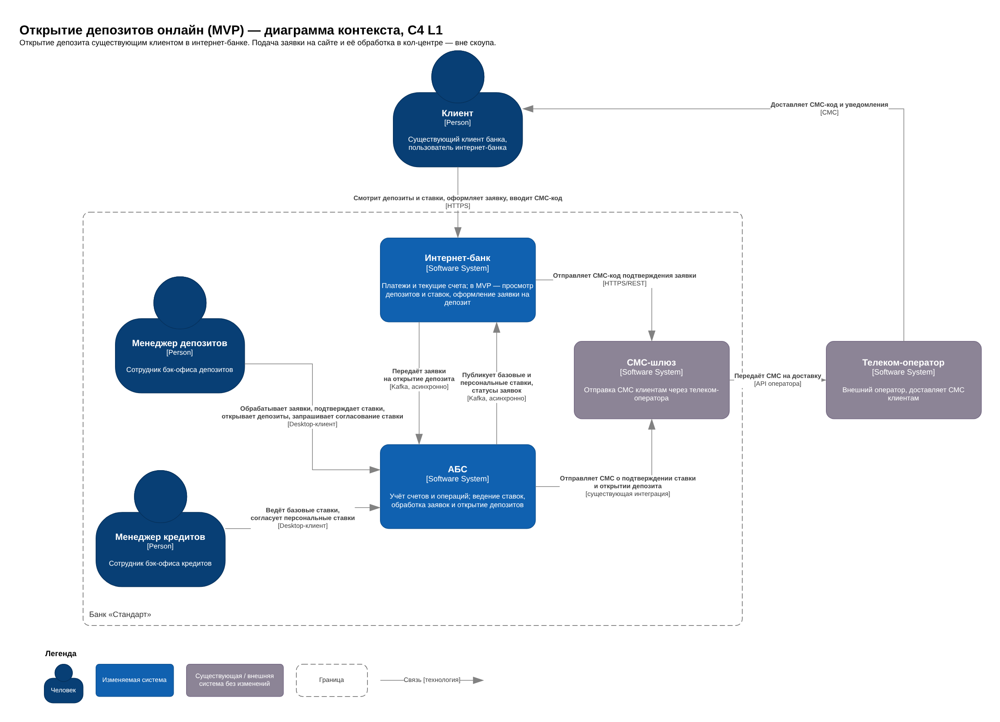
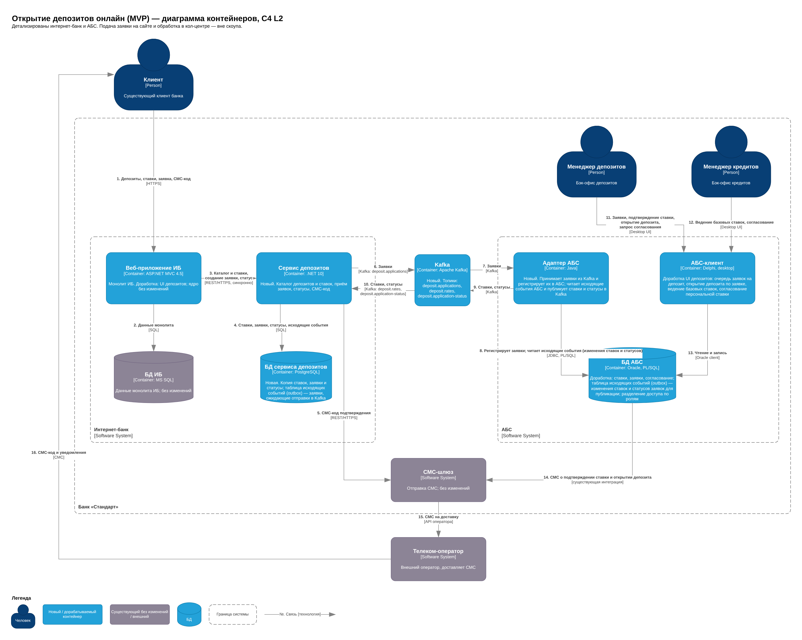

### **Название задачи:** Открытие депозитов онлайн — концептуальная архитектура MVP
### **Автор:** Лямин А.
### **Дата:** 26.10.2026

**Границы решения:** открытие депозита существующим клиентом в интернет-банке (MVP, 6 месяцев). Подача заявки на сайте и её обработка в кол-центре — вне скоупа данного ADR, рассматриваются отдельным решением.
### **Функциональные требования**

|**№**|**Действующие лица или системы**|**Use Case**|**Описание**|
| :-: | :- | :- | :- |
|UC-1|Клиент, интернет-банк, АБС|Просмотр депозитов и ставок в интернет-банке|1. Клиент открывает раздел депозитов в интернет-банке. 2. Базовые и персональные ставки поступают из АБС. 3. ИБ показывает список депозитов с актуальными базовыми и персональными ставками.|
|UC-2|Клиент, интернет-банк, СМС-шлюз, АБС|Оформление заявки на депозит в интернет-банке|1. Клиент выбирает депозит и оформляет заявку. 2. ИБ отправляет СМС-код через СМС-шлюз. 3. Клиент вводит СМС-код. 4. ИБ подтверждает приём заявки и показывает статус «Принята». 5. Заявка передаётся в АБС. Если АБС недоступна, заявка передаётся после её восстановления.|
|UC-3|Бэк-офис депозитов, АБС|Обработка заявки и открытие депозита|1. Сотрудник бэк-офиса депозитов видит новую заявку в АБС. 2. Сотрудник подтверждает ставку. Если нужна особая ставка — UC-6. 3. Сотрудник открывает депозит в АБС. 4. Статус заявки в АБС меняется.|
|UC-4|Клиент, АБС, СМС-шлюз, интернет-банк|Уведомление клиента и статус заявки|1. АБС отправляет клиенту через СМС-шлюз уведомление о подтверждении ставки. 2. АБС отправляет клиенту через СМС-шлюз уведомление об открытии депозита. 3. Изменения статуса заявки передаются в ИБ. 4. Клиент видит актуальный статус заявки в ИБ.|
|UC-5|Бэк-офис кредитов, АБС, интернет-банк|Ведение ставок в АБС|1. Бэк-офис кредитов рассчитывает и вносит базовые ставки в АБС вместо Excel. 2. Изменения ставок отображаются в ИБ не позже чем через 5 минут.|
|UC-6|Бэк-офис депозитов, бэк-офис кредитов, АБС|Согласование персональной ставки в АБС|1. Бэк-офис депозитов создаёт в АБС запрос на согласование персональной ставки по заявке. 2. Бэк-офис кредитов согласует ставку или отклоняет запрос и предлагает другую. 3. Бэк-офис депозитов видит ответ в АБС и продолжает обработку заявки (UC-3).|

### **Нефункциональные требования**

|**№**|**Требование**|
| :-: | :- |
||**Надёжность**|
|R-1|Режим работы ИБ — 24/7|
|R-2|Доступность ИБ — не менее 99,9%|
|R-3|При отказе ЦОД работа ИБ восстанавливается не более чем за 15 минут с сохранением требуемой нагрузки|
|R-4|При недоступности АБС ИБ продолжает показывать список депозитов со ставками и принимать заявки; заявки обрабатываются после восстановления АБС|
|R-5|Заявки и уведомления не теряются и не дублируются|
||**Производительность**|
|P-1|Время ответа на операции клиента в ИБ: просмотр депозитов и ставок — до 300 мс, отправка заявки (до подтверждения приёма) — до 500 мс; для 95% запросов|
|P-2|Загрузка справочников в ИБ — до 300 мс (сейчас больше 1 с)|
|P-3|Изменение ставки в АБС отображается в ИБ не позже чем через 5 минут|
|P-4|Горизонтальное масштабирование новых сервисов, балансировка между серверами и ЦОД|
|P-5|Выдерживать пиковую нагрузку до 10 раз выше средней при маркетинговых кампаниях без нарушения времени ответа|
||**Ограничения**|
|+R-1|ИБ не обращается напрямую к БД или API АБС|
|+R-2|АБС масштабируется только вертикально|
|+R-3|Ядро ИБ не дорабатывается: СМС-функции реализует команда банка через СМС-шлюз|
|+R-4|Функционал депозитов — отдельные сервисы вне монолита ИБ|
|+R-5|Очереди сообщений — Kafka (только в новых сервисах)|
|+R-6|Существующий стек: MS SQL, Oracle, PostgreSQL, .NET, Java; новые технологии — совместимые и с экспертизой в банке|
|+R-7|Шифрование трафика (TLS 1.2+)|
|+R-8|Обработка ПДн по 152-ФЗ|
|+R-9|Разделение данных депозитного и кредитного направлений|
|+R-10|Онлайн-открытие депозита в ИБ — только для существующих клиентов банка|

### **Решение**

#### Диаграмма контекста (C4 L1)

Файлы: [C4_L1_Context.png](C4_L1_Context.png), исходник [C4_L1_Context.drawio](C4_L1_Context.drawio).

В решении изменяются две системы — интернет-банк (ИБ) и АБС. СМС-шлюз и телеком-оператор используются без изменений.

- Клиент работает только с ИБ: смотрит депозиты и ставки, оформляет заявку, подтверждает её СМС-кодом.
- ИБ и АБС взаимодействуют асинхронно через Kafka: ИБ передаёт заявки, АБС публикует ставки и статусы заявок. Прямого доступа ИБ к БД АБС в новом функционале нет (+R-1).
- Менеджеры бэк-офисов депозитов и кредитов работают в АБС: обработка заявок, ведение и согласование ставок вместо Excel и почты.
- СМС-код отправляет ИБ, уведомления о подтверждении ставки и открытии депозита — АБС; оба потока идут через существующий СМС-шлюз.

#### Диаграмма контейнеров (C4 L2)

Файлы: [C4_L2_Container.png](C4_L2_Container.png), исходник [C4_L2_Container.drawio](C4_L2_Container.drawio).

|**Контейнер**|**Технология**|**Статус**|**Назначение**|**Команда**|
| :- | :- | :- | :- | :- |
|Веб-приложение ИБ|ASP.NET MVC 4.5|Доработка UI|Монолит ИБ. Новые страницы депозитов; вызывает сервис депозитов по REST. Ядро не меняется (+R-3)|Команда ИБ|
|БД ИБ|MS SQL|Без изменений|Данные монолита|—|
|Сервис депозитов|.NET 10|Новый|Каталог депозитов и ставок, приём заявок, статусы, отправка СМС-кода|Команда ИБ|
|БД сервиса депозитов|PostgreSQL|Новый|Копия ставок, заявки и статусы, таблица исходящих событий (outbox)|Команда ИБ|
|Kafka|Apache Kafka|Новый|Шина событий между ИБ и АБС. Топики: `deposit.applications`, `deposit.rates`, `deposit.application-status`|IT-инфраструктура|
|Адаптер АБС|Java|Новый|Принимает заявки из Kafka и регистрирует их в АБС; читает исходящие события АБС и публикует ставки и статусы в Kafka|Команда АБС|
|АБС-клиент|Delphi|Доработка UI|Очередь заявок на депозит, открытие депозита по заявке, ведение базовых ставок, согласование персональной ставки|Команда АБС|
|БД АБС|Oracle, PL/SQL|Доработка|Таблицы и процедуры ставок, заявок и согласования; outbox изменений ставок и статусов; разделение доступа депозиты/кредиты по ролям (+R-9)|Команда АБС|
|СМС-шлюз|—|Без изменений|Отправка СМС через телеком-оператора|IT-инфраструктура|

#### Покрытие Use Cases

|**Use Case**|**Как реализуется (номера связей на L2)**|
| :- | :- |
|UC-1 Просмотр депозитов и ставок|Ставки из АБС через outbox и адаптер публикуются в Kafka (8, 9) → сервис депозитов сохраняет копию в своей БД (10, 4) → веб-приложение ИБ получает каталог по REST (3) и показывает клиенту (1)|
|UC-2 Оформление заявки|Клиент оформляет заявку в ИБ (1, 3) → сервис отправляет СМС-код через СМС-шлюз (5, 15, 16) → после ввода кода сохраняет заявку со статусом «Принята» и событие в outbox (4) → публикует в Kafka (6) → адаптер регистрирует заявку в БД АБС (7, 8)|
|UC-3 Обработка заявки и открытие депозита|Менеджер депозитов в АБС-клиенте видит заявку, подтверждает ставку, открывает депозит (11, 13)|
|UC-4 Уведомление и статус заявки|АБС отправляет СМС через существующую интеграцию (14, 15, 16); изменение статуса пишется в outbox АБС → адаптер → Kafka → сервис депозитов → ИБ (8, 9, 10, 3)|
|UC-5 Ведение ставок|Менеджер кредитов ведёт базовые ставки в АБС-клиенте (12, 13); изменения публикуются в ИБ как в UC-1|
|UC-6 Согласование персональной ставки|Запрос и ответ между бэк-офисами внутри АБС с разделением доступа по ролям (11, 12, 13)|

#### Ключевые решения и обоснование

1. **Функционал депозитов — отдельный сервис вне монолита ИБ** (+R-3, +R-4, +R-5). В монолите меняется только UI. Сервис не хранит состояние в памяти и масштабируется горизонтально (P-4, P-5).
2. **Стек сервиса — .NET 10 (LTS)** (+R-6). Владелец сервиса — команда ИБ с экспертизой в .NET.
3. **Собственная БД сервиса с копией ставок** (R-4, P-1, P-3). ИБ показывает ставки и принимает заявки без обращения к АБС, поэтому работает при её недоступности и отвечает быстро. Задержка обновления ставок определяется интервалом опроса outbox АБС и укладывается в 5 минут.
4. **Асинхронная интеграция ИБ ↔ АБС через Kafka** (+R-1, +R-2, +R-5, R-4). Kafka хранит заявки, пока АБС недоступна, и не создаёт дополнительной синхронной нагрузки на АБС, которая масштабируется только вертикально.
5. **Outbox в БД сервиса депозитов и в БД АБС** (R-5). Событие записывается в одной транзакции с данными и отправляется в Kafka фоновым процессом, поэтому не теряется при сбое между записью в БД и отправкой. Повторная доставка отсекается по идентификатору заявки (идемпотентная обработка в адаптере и сервисе).
6. **Адаптер АБС на Java** (+R-6). Изолирует Oracle от Kafka: PL/SQL-логика не работает с брокером напрямую. Владелец — команда АБС, в которой есть специалисты по Java.
7. **Ставки и согласование — в АБС** (UC-5, UC-6, +R-9). АБС остаётся единственным источником ставок; ролевое разделение доступа заменяет обмен данными по почте между депозитным и кредитным направлениями.
8. **СМС-код отправляет сервис депозитов через существующий СМС-шлюз** (+R-3). Ядро ИБ не дорабатывается; доработку делает команда банка.
9. **Развёртывание в двух ЦОД** (R-1, R-2, R-3). Сервис депозитов, PostgreSQL (с репликацией) и Kafka (кластер) разворачиваются в основном и резервном ЦОД с балансировкой. На диаграммах развёртывание не показано, детализируется отдельно.
10. **Безопасность** (+R-7, +R-8). Все внешние и межсервисные взаимодействия — по TLS 1.2+; ПДн хранятся в контуре банка.

#### Команды-участники

|**Команда**|**Зона ответственности**|
| :- | :- |
|Команда ИБ (банк, 10 чел.)|UI депозитов в монолите, сервис депозитов и его БД, интеграция с Kafka и СМС-шлюзом|
|Подрядчик ИБ (10 чел.)|Консультации по платформе монолита; доработка ядра не требуется|
|Команда АБС (20 чел.)|UI в Delphi-клиенте, таблицы и PL/SQL-процедуры, outbox, ролевой доступ, адаптер на Java|
|IT-инфраструктура банка|Развёртывание Kafka и PostgreSQL в двух ЦОД, балансировка, мониторинг; сопровождение СМС-шлюза|
|Команда цифровой трансформации (10 чел.)|Владелец продукта: требования, приоритеты, координация команд, приёмка|
|Бэк-офисы депозитов и кредитов|Пользователи АБС; участие в приёмке новых экранов и процессов|

#### Допущения

- Пополнение открытого депозита выполняется существующим функционалом ИБ (переводы между своими счетами) и в скоуп MVP не входит.
- Существующая прямая интеграция ИБ с БД АБС для платежей и текущих счетов в MVP не меняется; ограничение +R-1 применяется к новому функционалу.
- Kafka и PostgreSQL сопровождает IT-инфраструктура банка; отдельной платформенной команды нет.
### **Альтернативы**

|**№**|**Альтернатива**|**Плюсы**|**Минусы**|**Почему не выбрана**|
| :-: | :- | :- | :- | :- |
|1|Реализовать депозиты внутри монолита ИБ|Нет новых контейнеров, быстрее старт|Монолит не работает с Kafka, не масштабируется горизонтально; доработки зависят от платформы подрядчика|Противоречит +R-4, +R-5, P-4|
|2|Читать и писать данные напрямую в БД АБС, как сейчас для платежей|Минимум новых компонентов, привычный для команд подход|Жёсткая связность с внутренней схемой АБС; дополнительная нагрузка на АБС; при недоступности АБС ИБ не показывает ставки и не принимает заявки|Противоречит +R-1, R-4, +R-2|
|3|Синхронный REST API к АБС вместо Kafka|Простая модель, мгновенный ответ о статусе|У АБС нет API — его нужно создавать; вся пиковая нагрузка идёт на АБС; при её недоступности заявки не принимаются без отдельного буфера|Не выполняются R-4 и P-5 с учётом +R-2|
|4|Отправлять события в Kafka напрямую, без outbox|Проще реализация, нет таблиц исходящих событий|Событие теряется при сбое между записью в БД и отправкой в Kafka|Не выполняется R-5|
|5|Публикация в Kafka прямо из Oracle (PL/SQL) без адаптера|Нет нового Java-контейнера|Нестандартная интеграция PL/SQL с Kafka, сложная поддержка и диагностика; логика интеграции смешивается с учётной|Выбран отдельный адаптер на Java с экспертизой в команде АБС|
|6|Сервис депозитов на Java|Единый стек с адаптером АБС|Владелец сервиса — команда ИБ, её основная экспертиза — .NET|Выбран .NET (+R-6)|
|7|Отдельный фронтенд депозитов (SPA) вместо доработки UI монолита|Современный UI, независимый релизный цикл|Ещё один контейнер, авторизация и встраивание в ИБ; дольше для MVP|Отложено: для MVP достаточно доработки UI монолита|

**Недостатки, ограничения, риски**

|**№**|**Недостаток, ограничение или риск**|**Последствия**|**Меры**|
| :-: | :- | :- | :- |
|1|Итоговая согласованность: ставки и статусы в ИБ обновляются с задержкой до 5 минут|Клиент может оформить заявку по ставке, которая уже изменилась в АБС|Ставка фиксируется в заявке; бэк-офис подтверждает её (UC-3), клиент получает СМС о подтверждении ставки (UC-4)|
|2|Копия ставок в БД сервиса депозитов|Риск расхождения с АБС при потере или ошибке события|АБС — единственный источник ставок; периодическая полная перепубликация ставок; мониторинг расхождений|
|3|Доработки АБС (Delphi, PL/SQL, адаптер) — на критическом пути MVP|Команда АБС (20 чел.) становится узким местом, срок MVP зависит от неё|Раннее начало работ; приоритизация доработок АБС; согласованный контракт событий до начала разработки|
|4|Ручная обработка заявок бэк-офисом в MVP|При пиках (P-5) очередь заявок растёт; срок открытия депозита определяется загрузкой бэк-офиса, а не ИТ-систем|Мониторинг очереди заявок; статус заявки в ИБ; переход к автоматическому открытию на следующем этапе|
|5|АБС масштабируется только вертикально|Рост числа заявок и пользователей увеличивает нагрузку на АБС|Kafka сглаживает пики; адаптер обрабатывает заявки с ограниченной скоростью; ИБ не обращается к АБС синхронно|
|6|Новые для банка технологии в эксплуатации: Kafka, PostgreSQL, .NET 10|Нужны компетенции по эксплуатации; без платформенной команды нагрузка ложится на IT-инфраструктуру|Обучение; управляемые конфигурации в двух ЦОД; централизованный мониторинг и логирование|
|7|Асинхронный сценарий сложнее диагностировать|Трудно найти, на каком шаге «застряла» заявка|Сквозной идентификатор заявки во всех системах; мониторинг задержек топиков и outbox; алерты|
|8|Существующая прямая интеграция ИБ с БД АБС для платежей остаётся|+R-1 выполняется только для нового функционала; сохраняется жёсткая связность|Перевод платежей на интеграцию через Kafka — отдельным этапом|
|9|UI депозитов в устаревшем монолите (.NET Framework 4.5)|Ограничения по UX и дизайн-системе; обновление ядра подрядчиком может затронуть новые страницы|Минимальная логика в UI, вся бизнес-логика — в сервисе депозитов; регрессионное тестирование при обновлениях ядра|
|10|Доставка СМС зависит от телеком-оператора|Задержка СМС-кода мешает оформить заявку|Ограниченный срок действия кода и повторная отправка; мониторинг доставки; на следующих этапах — резервный канал доставки кода и уведомлений через мессенджеры|
|11|ПДн и банковские данные проходят через Kafka|Новая точка возможной утечки; нарушение разделения депозитов и кредитов|Минимум ПДн в событиях; TLS 1.2+; права доступа к топикам по сервисам; данные кредитного направления в топики депозитов не публикуются (+R-9)|
