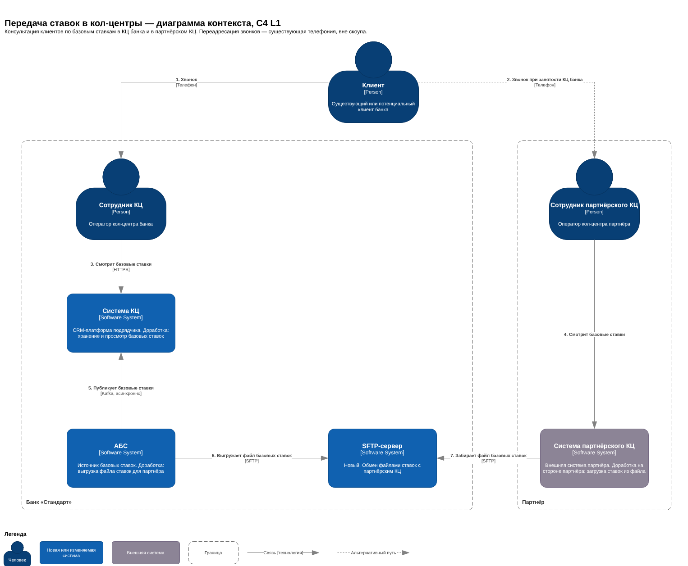
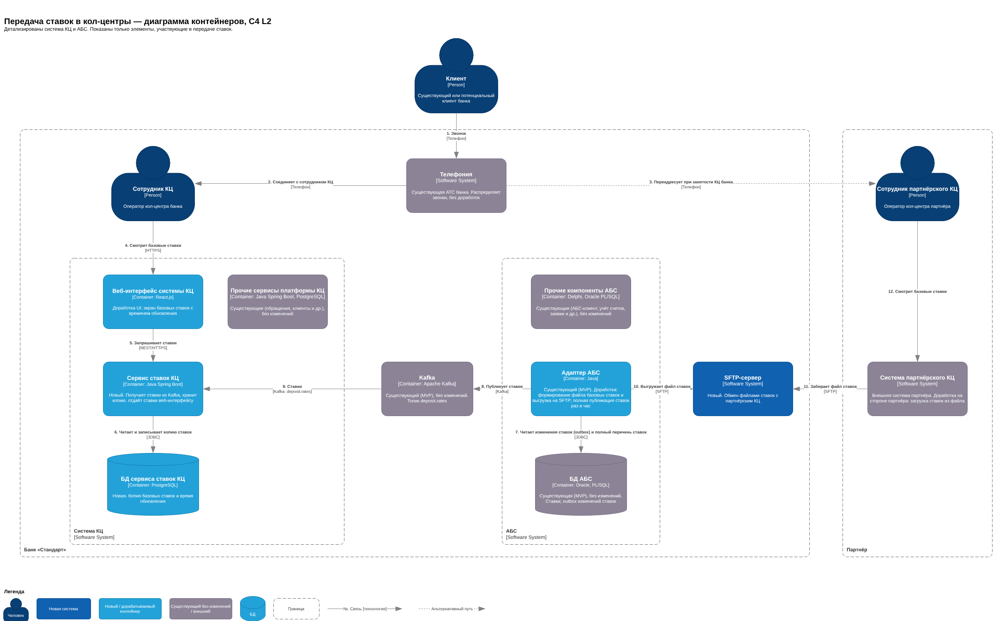

### **Название задачи:** Передача ставок в кол-центр и партнёрский кол-центр
### **Автор:** Лямин А.
### **Дата:** 28.10.2026

**Границы решения:** консультация клиентов по базовым ставкам по депозитам и накопительным счетам в кол-центре (КЦ) банка и в партнёрском КЦ. Решение дополняет MVP открытия депозитов онлайн (ADR задания 3) и использует его текущий процесс работы со ставками: ставки ведутся в АБС, изменения публикуются адаптером АБС в Kafka (топик `deposit.rates`). Оформление заявок через КЦ, персональные ставки и маршрутизация звонков — вне скоупа.
### **Функциональные требования**

|**№**|**Действующие лица или системы**|**Use Case**|**Описание**|
| :-: | :- | :- | :- |
|UC-1|Клиент, сотрудник КЦ, сотрудник партнёрского КЦ|Звонок в КЦ|1. Клиент соединяется со свободным сотрудником КЦ. 2. Если все сотрудники заняты, звонок переадресуется в партнёрский КЦ.|
|UC-2|АБС, система КЦ|Получение актуальных ставок системой КЦ|1. АБС фиксирует изменение ставки. 2. АБС публикует изменение ставок. 3. Система КЦ получает и сохраняет актуальные ставки.|
|UC-3|Сотрудник КЦ, система КЦ|Консультация по ставкам в КЦ банка|1. Сотрудник открывает систему КЦ и изучает актуальное предложение по ставкам. 2. Сотрудник КЦ сообщает актуальную информацию клиенту.|
|UC-4|АБС, SFTP-сервер|Формирование и выгрузка файла ставок для партнёра|1. АБС фиксирует изменение ставки. 2. АБС формирует файл с актуальными ставками. 3. АБС выгружает файл на SFTP-сервер.|
|UC-5|Система партнёрского КЦ, SFTP-сервер|Получение файла и загрузка ставок партнёром|1. Система партнёрского КЦ забирает файл с SFTP-сервера. 2. Система партнёрского КЦ загружает ставки.|
|UC-6|Сотрудник партнёрского КЦ, система партнёрского КЦ|Консультация по ставкам в партнёрском КЦ|1. Сотрудник открывает систему партнёрского КЦ и изучает актуальное предложение по ставкам. 2. Сотрудник партнёрского КЦ сообщает актуальную информацию клиенту.|

Допущения:
- UC-1: переадресацию звонков в партнёрский КЦ выполняет существующая телефония, доработки не требуются.
### **Нефункциональные требования**

|**№**|**Требование**|
| :-: | :- |
||**Надёжность**|
|R-1|При недоступности АБС система КЦ показывает последние полученные ставки с временем их обновления.|
|R-2|Ставки в системе КЦ полностью обновляются из АБС не реже 1 раза в час, даже если не менялись.|
|R-3|Партнёрскому КЦ доступен только полностью сформированный файл ставок.|
|R-4|Файл ставок формируется ежедневно до 08:00 МСК, даже если ставки не менялись.|
|R-5|Доступность SFTP-сервера — не менее 99,5%.|
||**Производительность**|
|P-1|Изменение ставки в АБС отображается в системе КЦ не позже чем через 5 минут.|
|P-2|Файл с изменёнными ставками доступен на SFTP-сервере не позже чем через 5 минут после изменения ставки в АБС.|
|P-3|Экран ставок в системе КЦ открывается до 1 с для 95% запросов при одновременной работе 200 операторов.|
||**Ограничения**|
|+R-1|Обмен данными с партнёрским КЦ — без API-вызовов.|
|+R-2|Обмен ставками с партнёрским КЦ — файлами по SFTP.|
|+R-3|Передаются только базовые ставки по депозитам и накопительным счетам; персональные ставки и ПДн не передаются (152-ФЗ).|
|+R-4|Источник ставок — АБС; новые прямые обращения к БД АБС не создаются.|
|+R-5|Система КЦ дорабатывается без изменения ядра платформы подрядчика.|
|+R-6|Партнёрский КЦ имеет на SFTP-сервере отдельную учётную запись с доступом только на чтение своего каталога.|
|+R-7|Файлы ставок хранятся на SFTP-сервере 30 дней.|

Допущения:
- R-2: периодичность полного обновления — 1 раз в час; в кейсе не задана.
- R-4: КЦ начинает работу в 08:00 МСК.
- R-5: доступность SFTP-сервера — 99,5%; в кейсе не задана.
- P-2: система партнёрского КЦ проверяет каталог на SFTP-сервере не реже 1 раза в 5 минут.
- +R-7: срок хранения файлов — 30 дней; в кейсе не задан.
### **Решение**

#### Диаграмма контекста (C4 L1)

Файлы: [C4_L1_Context.png](C4_L1_Context.png), исходник [C4_L1_Context.drawio](C4_L1_Context.drawio).

В решении изменяются система КЦ и АБС, появляется SFTP-сервер. Телефония используется без изменений, система партнёрского КЦ дорабатывается на стороне партнёра.

- Клиент звонит в банк; телефония соединяет его с сотрудником КЦ, а при занятости КЦ банка переадресует звонок в партнёрский КЦ.
- АБС — единственный источник ставок. В систему КЦ ставки передаются асинхронно через Kafka, партнёру — файлом через SFTP-сервер банка.
- Сотрудники обоих КЦ консультируют клиента по базовым ставкам из своих систем; к АБС при консультации они не обращаются.

#### Диаграмма контейнеров (C4 L2)

Файлы: [C4_L2_Container.png](C4_L2_Container.png), исходник [C4_L2_Container.drawio](C4_L2_Container.drawio).

|**Контейнер**|**Технология**|**Статус**|**Назначение**|**Команда**|
| :- | :- | :- | :- | :- |
|Веб-интерфейс системы КЦ|React.js|Доработка UI|Экран базовых ставок с временем их обновления; вызывает сервис ставок КЦ по REST|Подрядчик КЦ|
|Сервис ставок КЦ|Java Spring Boot|Новый|Подписка на `deposit.rates`, хранение копии ставок, API ставок для веб-интерфейса|Команда АБС (Java)|
|БД сервиса ставок КЦ|PostgreSQL|Новая|Копия базовых ставок и время обновления|Команда АБС (Java)|
|Прочие сервисы платформы КЦ|Java Spring Boot, PostgreSQL|Без изменений|Обращения, клиенты и др.|—|
|Kafka|Apache Kafka|Без изменений (MVP)|Топик `deposit.rates`; новый потребитель — сервис ставок КЦ|IT-инфраструктура|
|Адаптер АБС|Java|Доработка (MVP)|Публикация ставок в Kafka (по изменению и полная — раз в час); формирование файла ставок и выгрузка на SFTP|Команда АБС|
|БД АБС|Oracle, PL/SQL|Без изменений (MVP)|Ставки, outbox изменений ставок|—|
|Прочие компоненты АБС|Delphi, Oracle PL/SQL|Без изменений|АБС-клиент, учёт счетов, заявки и др.|—|
|SFTP-сервер|SFTP|Новый|Каталог партнёра с файлами ставок|IT-инфраструктура|

#### Диаграмма компонентов (C4 L3)

_(диаграмма будет добавлена)_

#### Покрытие Use Cases

|**Use Case**|**Как реализуется (номера связей на L2)**|
| :- | :- |
|UC-1 Звонок в КЦ|Телефония соединяет клиента с сотрудником КЦ или переадресует в партнёрский КЦ (1, 2, 3)|
|UC-2 Получение ставок системой КЦ|Адаптер читает изменения ставок из outbox АБС и публикует в Kafka (7, 8) → сервис ставок КЦ получает ставки и сохраняет копию (9, 6)|
|UC-3 Консультация в КЦ банка|Сотрудник КЦ открывает экран ставок (4) → веб-интерфейс запрашивает ставки у сервиса (5) → сервис читает копию из своей БД (6)|
|UC-4 Формирование и выгрузка файла|Адаптер читает полный перечень ставок из БД АБС (7), формирует файл и выгружает на SFTP-сервер (10)|
|UC-5 Получение файла партнёром|Система партнёрского КЦ забирает файл с SFTP-сервера и загружает ставки (11)|
|UC-6 Консультация в партнёрском КЦ|Сотрудник партнёрского КЦ смотрит ставки в своей системе (12)|

#### Ключевые решения и обоснование

1. **Ставки в систему КЦ — через существующий топик `deposit.rates`** (+R-4, R-1, P-1). Ставки уже публикуются в Kafka для ИБ (MVP); система КЦ становится ещё одним потребителем. Новый API к АБС не нужен, дополнительной синхронной нагрузки на АБС нет.
2. **Отдельный сервис ставок КЦ вместо доработки существующего бэкенда** (+R-5). Платформа КЦ — продукт подрядчика; новый микросервис — штатный способ её расширения. Доработку может выполнить команда банка, сбой сервиса не влияет на основную работу КЦ. В существующем веб-интерфейсе дорабатывается только экран ставок.
3. **Собственная копия ставок в БД сервиса** (R-1, P-3). Экран ставок не зависит от доступности АБС и Kafka и отвечает быстро; оператор видит время последнего обновления.
4. **Полная публикация ставок раз в час** (R-2). Сервис ставок КЦ перезаписывает копию полным перечнем; если отдельное изменение было потеряно, оно восстанавливается без обнаружения сбоя и ручного вмешательства. Повторное получение одних и тех же ставок безопасно.
5. **Файл для партнёра формирует адаптер АБС** (+R-2, P-2, R-4). Адаптер уже читает изменения ставок из outbox и имеет доступ к полному перечню ставок; выгрузка файла не зависит от Kafka. Файл формируется при каждом изменении ставок и ежедневно до 08:00, даже без изменений.
6. **В файле — полный перечень действующих базовых ставок, а не изменения** (R-3, R-4). Каждый файл самодостаточен: пропуск одного файла не приводит к неверным ставкам у партнёра. Формат — CSV (UTF-8) по спецификации, согласованной с партнёром; имя файла содержит дату и время формирования.
7. **SFTP-сервер в контуре банка, партнёр забирает файлы сам** (+R-1, +R-2, +R-6). Банк не открывает исходящих соединений к партнёру и не хранит его учётные данные; доступ партнёра — отдельная учётная запись по SSH-ключу, только чтение своего каталога, ограничение по IP-адресам партнёра.
8. **Файл виден партнёру только после полной записи** (R-3). Адаптер записывает файл под временным именем и переименовывает после завершения записи.
9. **Передаются только базовые ставки** (+R-3). Персональные ставки и ПДн в систему КЦ и партнёру не передаются; данные кредитного направления не публикуются (+R-9 ADR задания 3).
10. **Развёртывание** (R-5). SFTP-сервер разворачивается в основном и резервном ЦОД, как Kafka и PostgreSQL в MVP; файлы хранятся 30 дней (+R-7).

#### Команды-участники

|**Команда**|**Зона ответственности**|
| :- | :- |
|Команда АБС (20 чел., есть Java-разработчики)|Доработка адаптера АБС (полная публикация ставок, файл для партнёра); разработка сервиса ставок КЦ и его БД|
|Подрядчик платформы КЦ (5 чел.)|Экран ставок в веб-интерфейсе; консультации по встраиванию нового сервиса в платформу|
|IT-инфраструктура банка|Развёртывание SFTP-сервера в двух ЦОД, сетевой доступ партнёра, мониторинг; подключение нового потребителя к Kafka|
|Команда цифровой трансформации (10 чел.)|Владелец продукта: требования, согласование формата файла и регламента обмена с партнёром, приёмка|
|Партнёрский КЦ|Загрузка ставок из файлов в свою систему; скрипты консультаций от бизнеса банка|

#### Допущения

- Переадресацию звонков в партнёрский КЦ выполняет существующая телефония банка (UC-1).
- Значения R-2, R-4, R-5, P-2, +R-7 приняты без данных кейса (см. допущения к НФТ).
- Партнёр имеет сетевой доступ к SFTP-серверу банка (по VPN или с фиксированных IP-адресов).
- Существующий топик `deposit.rates` и outbox ставок в АБС реализуются в рамках MVP (ADR задания 3).
### **Альтернативы**

|**№**|**Альтернатива**|**Плюсы**|**Минусы**|**Почему не выбрана**|
| :-: | :- | :- | :- | :- |
|1|Доработка существующего бэкенда платформы КЦ вместо отдельного сервиса ставок|Меньше компонентов: не нужны новый сервис и БД, их развёртывание и мониторинг|Изменение кода платформы подрядчика; доработку делает и поддерживает подрядчик (5 чел.), срок MVP зависит от него; обновления платформы могут затронуть доработку; сбой подписки на ставки может повлиять на основную работу КЦ|Противоречит +R-5|
|2|Синхронный REST API адаптера АБС, который система КЦ вызывает при консультации|Ставки всегда из первоисточника, без копии|Новый API; синхронная нагрузка на АБС, которая масштабируется только вертикально; при недоступности АБС оператор не видит ставок|Не выполняется R-1; ставки уже есть в Kafka|
|3|Система КЦ получает ставки по REST у сервиса депозитов ИБ (там уже есть копия)|Не нужна своя копия ставок и подписка на Kafka|Зависимость КЦ от доступности и релизов ИБ; связь между системами разных команд без бизнес-необходимости|Источник ставок — АБС (+R-4); лишняя связность|
|4|Файл для партнёра формирует отдельный сервис-потребитель `deposit.rates`|Единый канал ставок через Kafka; адаптер АБС не дорабатывается|Ещё один контейнер; выгрузка партнёру зависит от доступности Kafka|Адаптер уже имеет доступ к ставкам АБС; меньше компонентов|
|5|Банк выгружает файлы на SFTP-сервер партнёра (push)|Партнёру не нужен доступ в сеть банка|Исходящие соединения из банка во внешнюю сеть, хранение учётных данных партнёра; зависимость от доступности инфраструктуры партнёра|Выбран SFTP в контуре банка (+R-6)|
|6|Отправка таблицы ставок партнёру по электронной почте|Не нужны новые компоненты, как в текущем процессе|Ручная обработка; нет гарантии доставки и полноты; ставки устаревают|Не выполняются R-3, P-2|
|7|В файле — только изменения ставок (дельта)|Меньше размер файлов|Пропуск одного файла приводит к неверным ставкам у партнёра; нужен механизм сверки|Не выполняется R-4; выбран полный перечень|

**Недостатки, ограничения, риски**

|**№**|**Недостаток, ограничение или риск**|**Последствия**|**Меры**|
| :-: | :- | :- | :- |
|1|Ставки у партнёра обновляются по его расписанию|Сквозной срок обновления ставок у партнёра зависит от партнёра, а не от банка (P-2)|Регламент обмена с партнёром: проверка каталога не реже 1 раза в 5 минут; ежедневный полный файл (R-4)|
|2|Итоговая согласованность: ставки в КЦ обновляются с задержкой до 5 минут|Оператор может назвать ставку, которая только что изменилась|Ставка фиксируется в заявке и подтверждается бэк-офисом (UC-3, UC-4 ADR задания 3); экран показывает время обновления ставок|
|3|Банк не видит, загрузил ли партнёр ставки в свою систему|Оператор партнёра может консультировать по устаревшим ставкам|Мониторинг логов SFTP-сервера (факт забора файла); оповещение, если файл не забран дольше заданного времени; дата формирования в имени файла|
|4|Файлы ставок передаются во внешнюю организацию|Новая точка возможной утечки данных|В файлах только публичные базовые ставки (+R-3); отдельная учётная запись, SSH-ключ, доступ только на чтение, ограничение по IP|
|5|Команда АБС участвует и в MVP, и в доработках этого решения|Команда становится узким местом, срок запуска сдвигается|Приоритизация задач; ранняя фиксация формата файла и контракта событий; сервис ставок КЦ при необходимости передаётся подрядчику КЦ|
|6|Экран ставок в UI платформы делает подрядчик КЦ (5 чел.)|Срок доработки зависит от загрузки подрядчика|Раннее согласование работ с подрядчиком; минимальный объём доработки UI|
|7|Изменение формата файла может нарушить загрузку у партнёра|Партнёр перестаёт получать актуальные ставки|Спецификация формата, согласованная с партнёром; версия формата в файле; изменения только с обратной совместимостью|
|8|SFTP-сервер — новый компонент в эксплуатации|Нагрузка на IT-инфраструктуру; недоступность сервера прерывает обмен с партнёром|Развёртывание в двух ЦОД; мониторинг; у партнёра остаётся последний полученный файл|
|9|Недоступность Kafka или сервиса ставок КЦ|Ставки в КЦ не обновляются|Экран показывает последние ставки и время обновления (R-1); выгрузка файла партнёру от Kafka не зависит; оповещение, если полная публикация не приходила дольше 1 часа|
|10|Рост числа звонков после маркетинговой кампании|Перегрузка КЦ банка и партнёрского КЦ|Архитектура обеспечивает только одинаковые ставки в обоих КЦ; объём звонков контролируется мониторингом нагрузки КЦ и бизнес-мерами|
